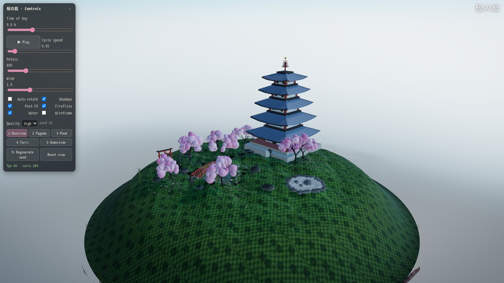
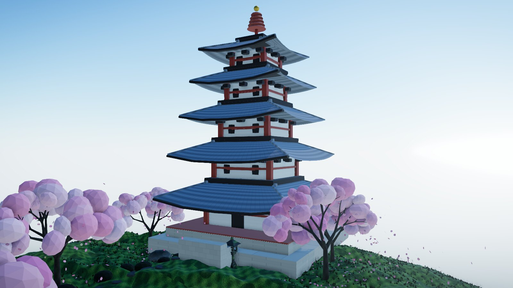
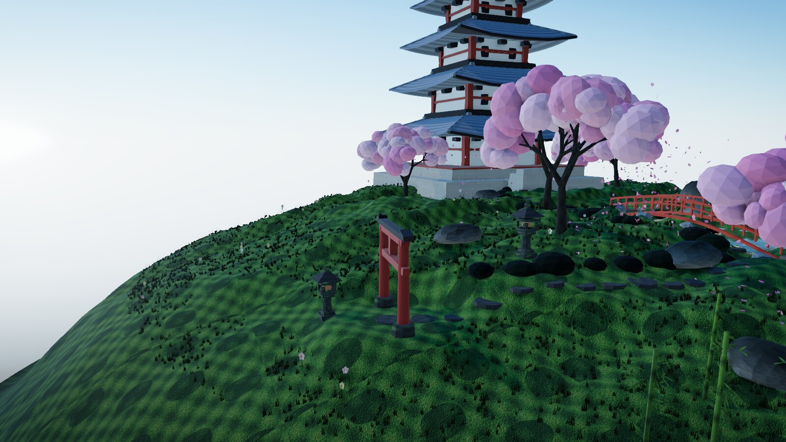
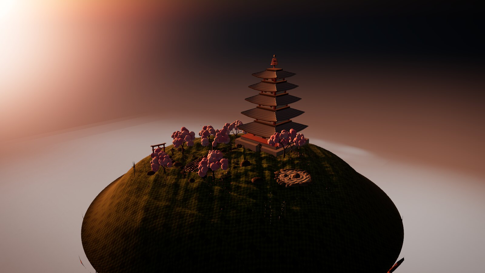
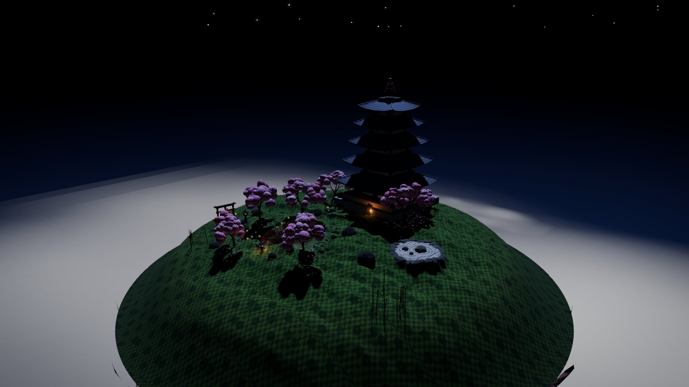
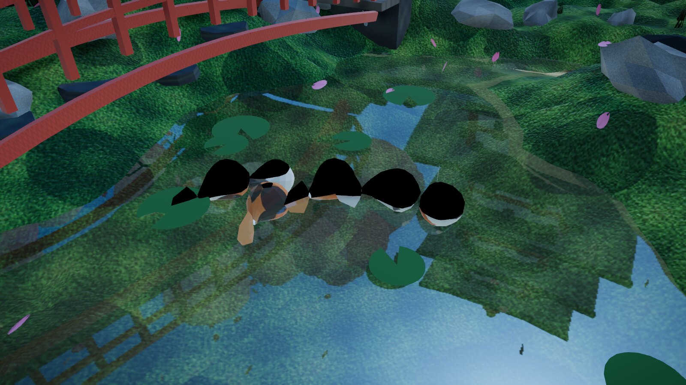

# Pagoda garden: Qwen3.8-27B building a 3D scene unattended for 12 hours

On 2026-11-25 the **Pi** coding agent, running only **Qwen3.8-27B Q8_0** from this machine's llama.cpp router
(preset `qwen3.8-27B-q8-128k`), built a real-time Three.js scene from a written brief: a Japanese pagoda garden on a
floating island, with a day/night cycle and a controls panel. Nobody answered questions or reviewed code during
the run. A loop extension started a fresh Pi session after every finished task, and each session picked up from a
handoff file.

**[Open the live demo](demo/pagoda/)**: it runs in the browser (WebGL2, a desktop GPU recommended). Keys `1`-`5`
switch camera presets, `N` toggles day and night, `Space` auto-rotates.

## The run in numbers

| | |
|---|---|
| Model | Qwen3.8-27B Q8_0, 128K context, q8_0 KV, MTP drafting; Pi 1.3.0, thinking `medium` |
| Wall clock | **11.8 hours** (01:54 to 13:43 UTC), unattended except one manual restart (below) |
| Tasks | 16 of 16 done, each with a written **Done when** check |
| Pi sessions | 21: one per task, four more to finish tasks handed off as partial, and one that ended after 3 minutes without work |
| Tool calls | 1,157 across 1,031 model replies; 3 automatic context compactions |
| Tokens | 984K generated; 56.5M prompt tokens, 55.6M of them served from the prompt cache |
| Result | 4,785 lines of JavaScript in 16 ES modules, every texture generated in code, no downloaded assets |
| Checks at the end | 0 console errors in all 8 review views, **60 fps** at 1600x900 on the RX 9070 XT, 180-288 draw calls, 24/24 control checks pass |

All of it is recomputed from Pi's session files by [`collect.py`](benchmarks/pi-pagoda/collect.py) into
[`run-stats.json`](benchmarks/pi-pagoda/run-stats.json). The loop log, task list and brief are in
[`benchmarks/pi-pagoda/loop/`](benchmarks/pi-pagoda/loop/).

## What it built

| Task | Minutes | What the session did |
|---|---:|---|
| T01 Scaffold | 10 | Vendored three.js r187, import map, renderer, orbit camera, seeded RNG, URL parameters, a `window.__diag` test contract |
| T02 Sky and lighting | 69 | Physical sky, sun path from the time of day, sky-lit environment map, soft shadows, moon, stars, fog. Found that the r187 Sky addon's clouds emit NaN near the horizon and black out everything lit by the environment map |
| T03 Floating island | 44 | Noise terrain, a craggy underside with rock strata, hanging roots, cloud layers; proved there are no holes with a 2,376-ray test |
| T04 Pagoda | 24 | Five tiers with curved, upturned roofs, brackets, plinth and spire, merged to 6 draw calls |
| T05 Pond and water | 76 | Carved basin, edge stones, lily pads, reflective water. Found that the Water addon takes its mirror plane from the mesh transform, not the vertices |
| T06 Koi | 132 | Six procedural koi in one draw call with a swimming wiggle |
| T07 Bridge, torii, lanterns | 53 | Arched bridge, torii gate, stone lanterns that light up at night, stepping-stone path |
| T08 Cherry trees | 33 | Seeded branching trees with blossom clusters and fallen petals |
| T09 Vegetation | 30 | 13,000 instanced grass blades in the wind, bamboo, shrubs, mossy rocks |
| T10 Zen garden | 78 | Raked gravel bed with ripple patterns around placed rocks |
| T11 Petals and fireflies | 35 | Falling petals driven by the wind, fireflies at night |
| T12 Post-processing | 51 | Ambient occlusion, bloom, anti-aliasing, vignette, low/high quality switch |
| T13 Controls panel | 21 | The panel in the screenshot above, keyboard shortcuts, camera tweens |
| T14 Control checks | 16 | A headless-Chrome script that drives each of the 24 controls and checks the effect |
| T15 Realism pass | 30 | Reviewed every view against the brief's rubric and fixed the weakest points |
| T16 Final review | 8 | Ran every acceptance check, wrote the README, saved the final screenshots |

## How the loop works

The project folder holds the brief and the state, so each session starts with a small context:

- `AGENTS.md`: the working rules: one task per session, never ask questions, log decisions, and finish a task in
  a fixed order (verify, tick the task, rewrite the handoff, commit, call `task_complete`).
- `.ai/project.md`: the brief, required scene elements, measurable acceptance checks and a 1-5 realism rubric
  ([copy](benchmarks/pi-pagoda/loop/project.md)).
- `.ai/tasks.md`: 16 ordered tasks, each with a **Done when** line ([final state](benchmarks/pi-pagoda/loop/tasks.md)).
- `.ai/handoff.md`: rewritten at the end of every task; the next session's only memory of the last one.
- `.pi/extensions/goal-loop.ts` ([source](benchmarks/pi-pagoda/loop/goal-loop.ts)): adds the `task_complete` and
  `goal_complete` tools. `task_complete` refuses unless the handoff was rewritten and the tree is committed; once the
  run settles, the extension opens a new session and sends the kickoff prompt. At 70% context it tells the agent to
  hand off a partial task.
- `tools/shot.mjs` ([source](benchmarks/pi-pagoda/loop/shot.mjs)): headless Chrome on the real GPU. It takes a
  screenshot per review view and reports console errors, FPS, the page's own `window.__diag` and image statistics.

## What the 27B could not see

Qwen3.8-27B takes no image input, so it never saw its own screenshots. Every visual judgement was made from
`shot.mjs`'s image statistics (brightness, dark and blown-out pixel shares, edge density, colour counts, dominant
hues) and from pixel probes it wrote itself, such as hiding the pagoda and diffing the water region to prove the
reflection was real. That worked for exposure, colour and "is this object there", and it is how the model found the
NaN sky and the vertical mirror plane. It did not work for shape and orientation, and the final rubric scores
(4 of 5 on every line) were scored blind. Looking at the final screenshots shows what slipped through:

- **The koi render as black shapes.** The merged koi mesh has no vertex normals, so lighting on it is undefined.
  The fish also face backwards on part of their loop (a transposed rotation). The pixel probe counted orange, white
  and black pixels, which black shapes satisfy.
- **The grass texture tiles visibly** into a checkerboard across the island.
- **The haze below the island glows white at night.**
- The overall look is stylised low-poly rather than the photoreal the brief asked for.

A vision-capable model, or a human glance once per task, would have caught all three bugs. Even so, the pagoda,
lighting, day cycle, water reflections and the whole controls panel came out of a 27B model with no human help.

## Where the loop went wrong

- **The model ignored "end your turn" (T06).** After its first `task_complete`, it kept calling tools in the same run.
  The new session only starts when the run ends, so it never started. The session ran 2.4 hours, compacted twice,
  and after the second `task_complete` the model wrote "A new session has started, and I'm resuming from
  .ai/handoff.md", acting out the handover, and began planning T07 at about 80% context. It was stopped and
  restarted by hand. The extension now blocks every tool call after `task_complete`, which forces the run to end, and
  the rest of the run rolled over on its own.
- **A repetition loop (T12).** The model called `task_complete` 15 times in a row in 2 minutes, each accepted and
  logged ([loop log](benchmarks/pi-pagoda/loop/loop-log.tsv)). It cost nothing but log lines; the reusable template
  now blocks repeat calls too.
- **The 70% context warning fired in 8 of 16 tasks.** Five (T02, T05, T06, T10, T12) were handed off as `partial` and
  finished by a later session; the other three finished within the context left. The handoff's "gotchas" section, carried forward each time, kept fixes such as the mirror plane from
  regressing.

## Source

The scene's repo, with the full commit history of the run (one or more commits per task), the brief, the task list,
the decision log and the loop extension: [kr4ckhe4d/qwen3.8-27B-q8-pagoda](https://github.com/kr4ckhe4d/qwen3.8-27B-q8-pagoda).
The live demo above is its final commit from the run, `2e001bf`, served as-is. The loop setup, with the fixes from this run, is a reusable template in [`loop templates/pi-goal-loop/`](<loop templates/pi-goal-loop/README.md>) and is also packaged as a Claude Code skill (`pi-goal-loop`) for reuse.
